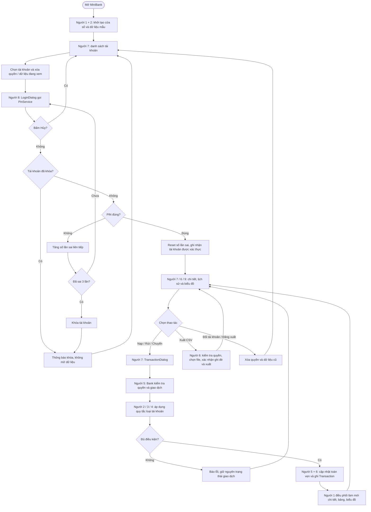
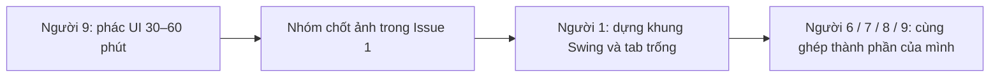
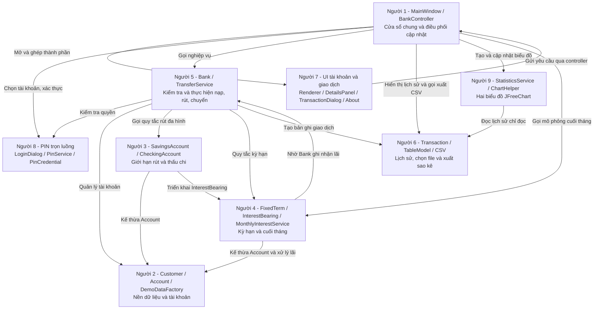
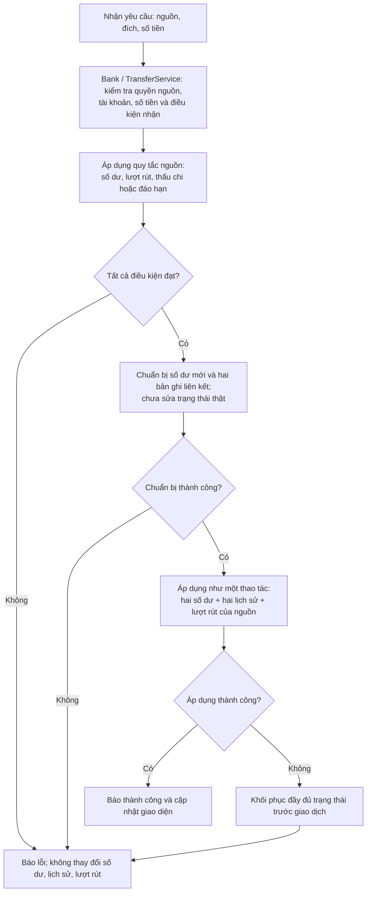
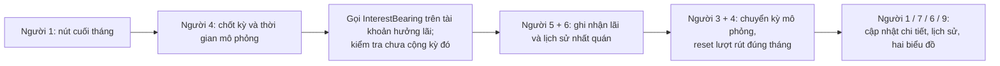

# Sơ đồ tổng hợp luồng MiniBank — nhóm 04

Đọc sơ đồ 1 để hiểu ứng dụng, sơ đồ 2 để biết phần mình nối vào đâu, sơ đồ 3 để hiểu chuyển khoản toàn vẹn. **Số người trong ô là số nhiệm vụ, không phải số Issue.** Đây là thiết kế bàn giao, chưa xác nhận code đã triển khai. Phạm vi: Java Swing, một máy, dữ liệu giả lập trong bộ nhớ.

## 1. Người dùng thao tác như thế nào?

- Hủy nhập PIN không tính là nhập sai. Tài khoản đã khóa không mở được bằng PIN đúng. Đóng/mở dialog không đặt lại số lần sai hoặc khóa.
- GUI chỉ nhập và hiển thị. **Bank/PinService vẫn kiểm tra quyền ở tầng nghiệp vụ**, kể cả khi gọi trực tiếp, không chỉ dựa vào trạng thái nút.
- Chuyển tiền chỉ xác thực tài khoản gửi; tài khoản nhận không cần PIN và vẫn nhận tiền khi bị khóa theo quy tắc mô phỏng của nhóm.
- Menu Help → About do người 7 làm, người 1 nối vào cửa sổ; đây là luồng xem thông tin nhóm, không thay đổi tài khoản.
- Luồng mô phỏng cuối tháng là tác vụ hệ thống của bản demo, xem phía dưới; không phải giao dịch rút tiền của tài khoản đang chọn.

## Chuẩn bị giao diện chung

Người 7 chỉ làm danh sách/chi tiết tài khoản, dialog giao dịch và About. Lịch sử/CSV thuộc người 6, PIN người 8, biểu đồ người 9. Không đổi API hoặc hạn chức năng. Xem [bản bàn giao](BAN_GIAO.md) để biết nội dung bản phác và cách chốt.

## 2. Chín người nối phần của mình vào đâu?

Mũi tên chỉ hướng **gọi hoặc sử dụng dữ liệu**, không có nghĩa phải đợi người trước viết xong. Chốt API trước, dùng dữ liệu mẫu để dựng UI/biểu đồ song song.

### Điểm bàn giao để không bị chờ

| Ai bàn giao? | Giao cho ai? | Phải chốt trước |
| --- | --- | --- |
| 2 | 3, 4, 5, 6, 7 | Constructor/getter Account, kiểu tiền, cách cập nhật số dư và lịch sử |
| 6 | 2, 5, 9 | Cấu trúc Transaction và dữ liệu lịch sử mẫu |
| 4 | 3, 5, 9 | InterestBearing, thời gian mô phỏng và kỳ tính lãi |
| 8 | 1, 2, 5 | API xác thực/quyền/khóa; kết quả LoginDialog |
| 5 | 1, 7 | API danh sách/chi tiết/nạp/rút/chuyển/lịch sử và lỗi trả về |
| 7 | 1 | Panel/dialog + callback, tự cùng ghép |
| 6 | 1 | TableModel + action CSV đã có chọn file/ghi đè |
| 9 | 1 | Chart/panel + cách cập nhật dataset, cấu hình JFreeChart |

**Hôm nay 16/10:** nhận và triển khai chữ ký/kiểu dữ liệu theo API v1 tại [API.md](API.md). **Trước 12:00 17/10:** có khung dùng chung biên dịch. **Chiều 17/10:** UI và biểu đồ có bản mẫu, không chờ nghiệp vụ đầy đủ. Không tự tạo Account/Transaction giả cùng tên ở package khác; mock ở bản thử phải được ghi rõ và thay bằng nghiệp vụ thật trước khi chốt.

## 3. Chuyển khoản phải cập nhật nguyên tử thế nào?

Người 2/3/5/6 phải thống nhất phần kiểm tra, chuẩn bị và áp dụng. Nếu đoạn áp dụng vẫn có thể lỗi, phải có cơ chế khôi phục cả số dư, lịch sử và lượt rút; không chỉ hoàn tiền nguồn bằng một giao dịch nạp mới. Tạo thử lỗi giữa chừng ở bản kiểm thử để chứng minh không cập nhật một nửa. Không cần thêm database cho phạm vi một máy này.

## 4. Mô phỏng cuối tháng

CheckingAccount không hưởng lãi. Tài khoản khóa vẫn được cộng lãi theo quy tắc demo. Không cộng trùng cùng tài khoản/kỳ; không cho số dư đã đổi mà lịch sử bị thiếu. Nếu một tài khoản xử lý lỗi, báo kết quả rõ ràng, không hiển thị thành công toàn bộ; lần thử lại phải bỏ qua tài khoản/kỳ đã thành công. Thứ tự chốt kỳ → cộng lãi → chuyển kỳ phải được người 3/4/5 thống nhất để không lệch giới hạn rút và timestamp.

## 5. Ai tổng hợp hồ sơ?

Mỗi người tự viết mô tả phần mình, ảnh, UML lớp liên quan, kết quả test và ghi chép Git/AI. Người 2 tổng hợp báo cáo, người 3 tổng hợp UML, người 6 tổng hợp bảng test, người 9 tổng hợp slide/video. Người 1 rà README và gói nộp.

Mốc: nội dung hồ sơ trước 18:00 ngày 19/10; ghép đủ chức năng tối 19/10; chốt toàn bộ 21:00 ngày 20/10; tập ngày 21/10; thuyết trình sáng 22/10. Chi tiết file, Issue và hạn từng người: [BAN_GIAO.md](BAN_GIAO.md). Quy tắc PIN/CSV/lãi và mã kiểm thử: [BONUS.md](BONUS.md).
