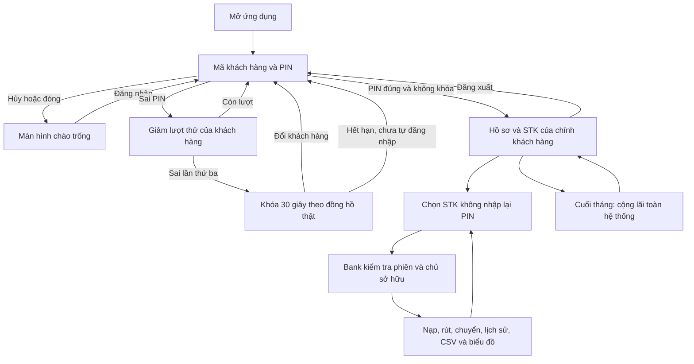

# Luồng ứng dụng API v2

Đăng xuất xóa cả danh sách STK, hồ sơ, lựa chọn, lịch sử và biểu đồ trước khi mở login.
Bank là cổng kiểm tra quyền, không chỉ dựa vào trạng thái nút giao diện. Chuyển khoản chỉ
xác thực chủ nguồn; người nhận có thể khác chủ và đang khóa đăng nhập. Đồng hồ mô phỏng
không ảnh hưởng hạn khóa PIN. Đóng app xóa dữ liệu trong RAM; mở lại nạp mẫu mới.

Chữ ký API: [API.md](API.md). Cách thao tác và PIN giả: [DEMO.md](DEMO.md).
