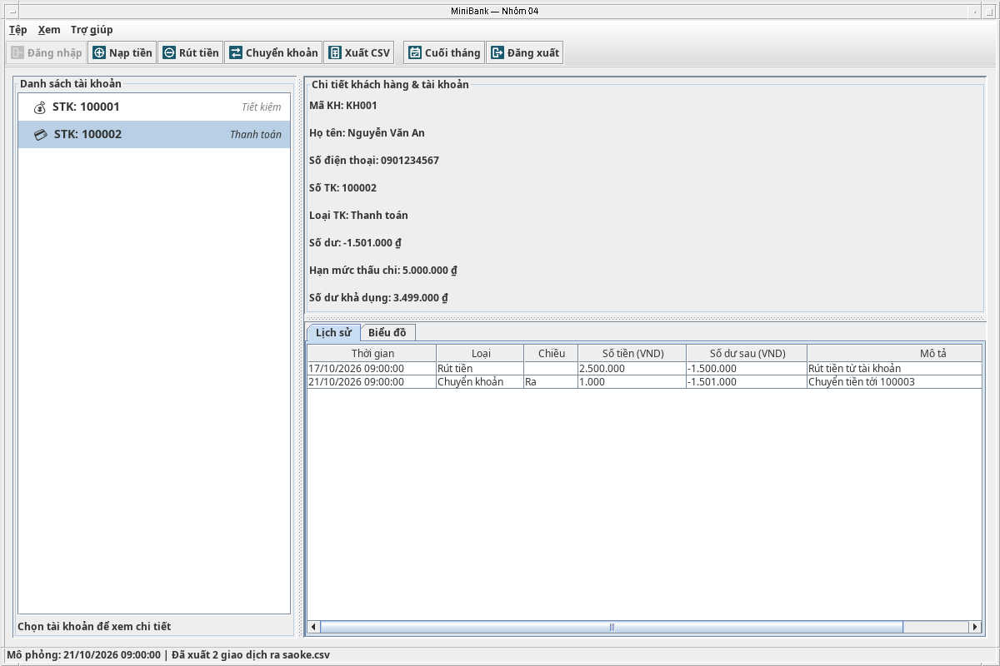
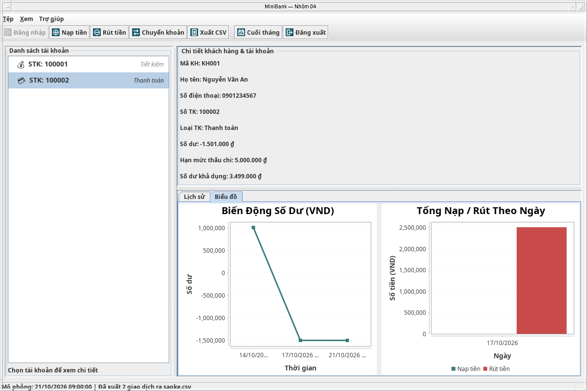
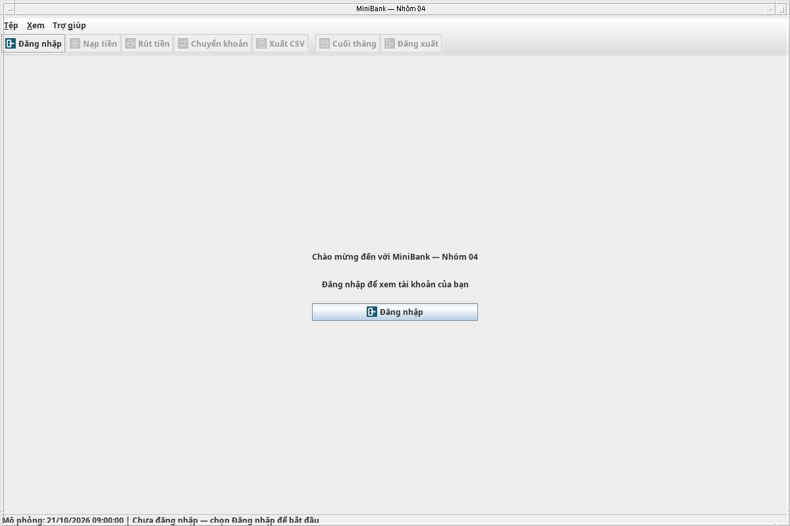

# Kiểm thử tích hợp API v2

Đã chạy trên nhánh tích hợp ngày **27/10/2026**, JDK tương thích Java 17, UTF-8.
Đã chạy lại toàn bộ sau khi ghép main `13d8f73` (PR #47) và bản sửa PIN `6ba8fb9` (PR #46).
Các ca nghiệp vụ dùng dữ liệu giả và Clock cố định/điều khiển được. Các ca Swing cần màn hình đồ họa.

```bash
./scripts/test.sh
./scripts/test.sh --gui
```

| Bộ kiểm thử | Số kiểm tra | Kết quả |
| --- | ---: | --- |
| AccountRepositoryTest | 34 | PASS |
| FixedTermAccountTest | 33 | PASS |
| PinServiceTest | 90 | PASS |
| BankIntegrationTest | 58 | PASS |
| DemoDataFactoryTest | 128 | PASS |
| BankV2Test (thành viên 5) | 33 | PASS |
| LoginDialogTest | 25 | PASS |
| BankControllerTest | 154 | PASS |
| **Tổng** | **555** | **PASS** |

Ngoài ra, `PackagedLaunch` chạy **java -jar** với cả thư mục dist được copy sang thư mục tạm
bên ngoài project: PASS. Ca này dùng Java agent chỉ để quan sát màn hình khởi động và tự đóng
bản thử; agent không được đóng gói trong ứng dụng bàn giao.

## Các trường hợp đã xác nhận

| Ca | Kết quả mong đợi | Kết quả thực tế |
| --- | --- | --- |
| Mở app/Hủy/X ở login | Không hiện STK, hồ sơ, lịch sử; còn nút Đăng nhập | PASS |
| PIN có số 0 đầu; mã có khoảng trắng | Đăng nhập đúng khách hàng sau chuẩn hóa | PASS |
| Đổi giữa STK cùng chủ | Không mở login mới, giữ phiên | PASS |
| Đăng xuất rồi đăng nhập người khác | Xóa toàn bộ dữ liệu người trước; chỉ hiện STK người sau | PASS |
| Gọi trực tiếp Bank trên STK người khác | Chặn xem/lịch sử/nạp/rút/chuyển từ nguồn khác chủ, không đổi model | PASS |
| PIN sai/null/sai định dạng ba lần | Khóa đúng khách hàng; không ảnh hưởng người khác | PASS |
| 29,999 giây và 30 giây | Trước hạn còn khóa/hiện 1 giây; đúng hạn mở khóa và có 3 lượt, chưa tự login | PASS |
| PIN đúng/thử lại/đổi dialog trong lúc khóa | Không vượt qua hoặc kéo dài khóa | PASS |
| Bấm Cuối tháng trong khi một khách hàng khóa | Không làm hết khóa theo thời gian thật; vẫn cộng lãi hệ thống | PASS |
| Chuyển tới khách hàng khác đang khóa | Thành công; hai bản ghi OUT/IN cùng mã tham chiếu và timestamp | PASS |
| Gây lỗi lúc tạo bản ghi phía nhận | Khôi phục hai số dư/hai lịch sử và lượt rút Savings | PASS |
| Lỗi cộng lãi sau tài khoản đầu | Giữ kỳ, hiện phần đã cộng; thử lại không cộng trùng | PASS |
| Rút/chuyển FixedTerm trước/đúng ngày đáo hạn | Trước hạn bị chặn với ngày dd/MM/yyyy; đúng ngày được phép | PASS |
| Số tiền null/0/âm/có phần lẻ | Bị từ chối; số nguyên có đuôi .00 hợp lệ | PASS |
| Lỗi vẽ biểu đồ sau giao dịch | Giao dịch chỉ chạy một lần; báo lỗi UI và cho làm mới | PASS |
| Dialog nạp và chuyển thật | Gọi đúng Bank, trim STK đích; đóng dialog trước callback | PASS |
| JFileChooser/CSV thật | Xuất đúng header và số dòng của STK được phép | PASS |
| Đưa lịch sử người khác vào luồng xuất | Bank từ chối trước khi sửa file | PASS |
| PNG toolbar/window, tài nguyên trong JAR | Có icon và tải được khi chạy ngoài project | PASS |
| Dữ liệu mẫu tạo mới | Các bộ model độc lập, số dư/lịch sử nhất quán | PASS |

Ảnh từ ca Swing thật:







## Giới hạn của kết quả

Đây là kiểm thử ứng dụng Swing một máy theo phạm vi nhóm. Các điểm kiểm tra lỗi dùng
đối tượng giả lập gây lỗi có chủ đích; kết quả không xác nhận hỗ trợ nhiều người đăng nhập
đồng thời qua mạng. JAR đã thử trên máy Linux hiện tại trong thư mục riêng; thành viên vẫn
cần thử trên máy Windows/Eclipse dự định dùng thuyết trình. Không có lưu dữ liệu qua lần mở app.
